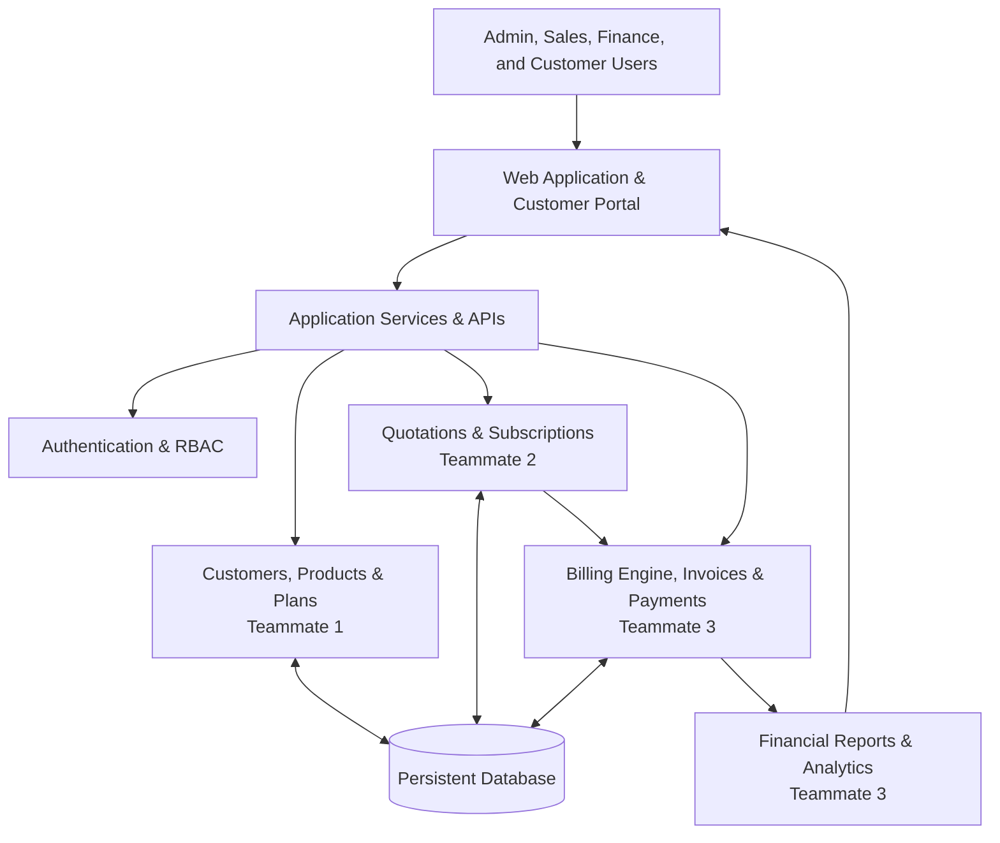
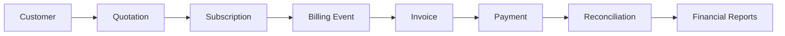

<div align="center">

# BRIGHTLOOP NEXUS

### One workspace. Every subscription. Complete financial clarity.

A subscription management platform for businesses to manage customers, plans, quotations, subscriptions, recurring billing, invoices, payments, and revenue operations in one place.

[Overview](#-overview) · [Features](#-features) · [Architecture](#-architecture) · [Getting Started](#-getting-started) · [Team & Ownership](#-team--ownership) · [Documentation](#-documentation) · [Contributing](#-contributing)

<br />


</div>

---

## ✨ Overview

**Brightloop Nexus** brings the complete subscription lifecycle into a single, connected workspace.

From the first customer quotation to subscription activation, recurring invoices, payment tracking, and revenue reporting, the platform is designed to help teams manage the commercial and financial side of subscription businesses with greater visibility and control.

Instead of disconnected spreadsheets and isolated tools, Brightloop Nexus provides a shared source of truth for customer, subscription, and billing information.

> **Our goal:** Make subscription operations easier to understand, easier to manage, and more reliable as a business grows.

---

## 🚀 Features

The following areas define the project scope. Feature availability is tracked collaboratively across all four teams:

| Area | Capabilities |
| --- | --- |
| **Customer Management** | Customer profiles, contact details, billing information, search, and customer history |
| **Products & Plans** | Product catalogue, subscription plans, pricing tiers, billing intervals, and active status |
| **Quotations** | Quotation creation, line items, discounts, expiry dates, approval, and subscription conversion |
| **Subscriptions** | Activation, trials, renewals, upgrades, downgrades, pauses, and cancellations |
| **Billing Engine** | Centralized billing engine, recurring billing cycles, idempotent invoice generation, and balance tracking |
| **Invoices** | Sequential numbering (`INV-2026-XXX`), line items, GST breakdown (CGST/SGST/IGST), due dates, and status transitions |
| **Payments** | Payment tracking, partial payments, simulated payment gateways, and duplicate transaction detection |
| **Reconciliation** | Automated audit comparing recorded payments against invoices, detecting over/underpayments and discrepancies |
| **Refunds** | Multi-step refund workflow (`requested` → `approved` → `completed`), balance replenishment, and refundable limits |
| **Analytics & Reports** | Real-time MRR, ARR, Accounts Receivable (AR), overdue balance exposure, and collection efficiency |
| **Customer Portal** | Customer-facing view of subscriptions, open invoices, and cleared payment history |
| **Access Control** | Authentication, role-based permissions (Admin, Finance, Sales, Customer), and protected business records |

---

## 🧭 Why Brightloop Nexus?

Subscription operations involve more than collecting a recurring payment. Teams need to understand who the customer is, what they purchased, when the next renewal is due, which invoices remain unpaid, and how each financial event affects the business.

Brightloop Nexus is built around four principles:

1. **Connected Workflows:** Customer, quotation, subscription, and billing records relate directly to one another.
2. **Reliable Financial Data:** Monetary calculations happen on the backend using high-precision Decimal and minor-unit representations, preserving transaction history.
3. **Useful Visibility:** Dashboards reflect actual application records rather than decorative sample data.
4. **Practical Engineering:** The application is maintainable, thoroughly tested, and runnable locally with clear commands.

---

## 🏗️ Architecture

Brightloop Nexus is organised into cooperating modules:



### Core Workflow



---

## 🧰 Technology Stack

- **Frontend Application:** React 19, TypeScript, Tailwind CSS, Vite, Lucide Icons
- **Web Server & Backend API:** Node.js, Express, TypeScript (`tsx`)
- **Billing & Financial Engine:** Python 3.12, `uv` package manager, Pydantic, Pytest (`Decimal` monetary precision)
- **Database & Data Store:** Relational persistent models with in-memory authoritative engine and API synchronization

---

## 📁 Repository Layout

```text
odoo/
├── billing/                     # TypeScript billing engine & route definitions
│   ├── billing_engine.ts        # Central invoice calculations & period keys
│   ├── billing_routes.ts        # Express endpoints for billing operations
│   ├── discount_manager.ts      # Discount validation & cap enforcement
│   └── tax_config.ts            # Indian GST (CGST/SGST/IGST) calculations
├── billing_engine/              # Python billing engine package (managed with uv)
│   ├── pyproject.toml           # uv project configuration
│   ├── src/billing_engine/      # Core Python financial modules
│   │   ├── engine.py            # Authoritative invoice generation
│   │   ├── models.py            # Pydantic models for billing entities
│   │   ├── payments.py          # Payments, refunds, and reconciliation
│   │   ├── reports.py           # Financial metrics (MRR, ARR, AR)
│   │   └── tax.py               # Decimal-based GST tax logic
│   └── tests/                   # Automated pytest suite (10/10 tests passing)
│       └── test_billing.py
├── bright_loop_frontend/        # Vite + Express full-stack application
│   ├── src/                     # React components, pages, and API client
│   │   ├── api/client.ts        # Typed API client SDK (includes api.billing.*)
│   │   ├── components/nexus/    # Workspace, billing, and reports views
│   │   └── billing/             # Integrated billing routes & models
│   ├── server.ts                # Express server mounting API & Vite middleware
│   └── package.json
├── docs/                        # Project documentation
│   └── BILLING_ENGINE.md        # Complete Team 3 billing specifications
├── README.md                    # Project overview and coordination guide
└── .gitignore                   # Ignores .venv, node_modules, and cache files
```

---

## ⚡ Getting Started

### Prerequisites

- **Node.js** (v18+)
- **Python** (v3.12+)
- **uv** package manager (`pip install uv` or via standalone installer)

### 1. Run the Frontend & Express API Server

```powershell
cd bright_loop_frontend
npm install
npm run dev
```

The application runs on `http://localhost:3000`.

### 2. Run the Billing Engine Test Suite (with `uv`)

```powershell
cd billing_engine
uv run pytest
```

---

## 👥 Team & Ownership

| Teammate | Focus Area | Responsibilities | Working Branch |
| --- | --- | --- | --- |
| **Teammate 1** | Foundation & Core | Database foundation, authentication, users, customers, products, plans | `team1/foundation` |
| **Teammate 2** | Workflows | Quotations, subscriptions, renewals, cancellations, lifecycle states | `team2/workflow` |
| **Teammate 3** | Billing & Financials | Billing engine, GST taxes, discounts, invoices, payments, refunds, reconciliation | `team3/billing` |
| **Teammate 4** | Frontend & Experience | UI shell, dashboard, customer portal, navigation, design system | `team4/frontend` |

---

## 📋 Git Workflow

- Work strictly on your designated team branch: `team3/billing`.
- Do not commit directly to `main`.
- Make small, incremental, meaningful commits.
- Push changes to your branch and create pull requests targeting `integration`.

```bash
# Checkout working branch
git checkout team3/billing

# Make changes and test
uv run pytest

# Commit and push
git add .
git commit -m "feat(billing): description of change"
git push origin team3/billing
```

---

## 🧪 Quality Standards

Every feature is developed and verified against these standards:

- **Dynamic Data:** Application workflows use persistent database records rather than decorative static numbers.
- **Financial Precision:** Strict `Decimal` and integer minor-unit arithmetic prevents floating-point inaccuracies.
- **Idempotency:** Billing cycles utilize unique period keys to prevent duplicate invoices.
- **Security:** Permissions enforced on backend; secrets stored in environment variables.
- **Testing:** Automated tests cover calculation edge cases, discount caps, refunds, and reconciliation.

---

## 🗺️ Roadmap

- [x] Confirm and document the application stack
- [x] Implement invoice generation and recurring billing (`team3/billing` - Completed)
- [x] Implement GST tax calculation engine (`team3/billing` - Completed)
- [x] Implement discount validation and cap rules (`team3/billing` - Completed)
- [x] Implement payment tracking, partial settlement, and simulation (`team3/billing` - Completed)
- [x] Implement refund lifecycle and balance enforcement (`team3/billing` - Completed)
- [x] Implement payment reconciliation audit (`team3/billing` - Completed)
- [x] Add automated test suite with `uv run pytest` (`team3/billing` - 10/10 Passed)
- [ ] Complete customer, product, and plan management (Team 1)
- [ ] Complete quotation and subscription workflows (Team 2)
- [ ] Build unified dashboard and customer portal integration (Team 4)
- [ ] Final end-to-end integration test

---

## 🔐 Security

- Never commit credentials, private API keys, or personal customer data.
- Use `.env.example` for environment variable templates.
- Financial transactions are signed and simulated securely without storing sensitive cardholder details.

---

## 📚 Documentation

Detailed documentation is available in the [`docs/`](docs/) directory:

| Document | Purpose |
| --- | --- |
| [`docs/BILLING_ENGINE.md`](docs/BILLING_ENGINE.md) | Team 3: Billing architecture, models, GST tax rules, discounts, refunds, and reconciliation |
| `docs/ARCHITECTURE.md` | Application structure and module relationships |
| `docs/DATABASE.md` | Data models and entity relationships |
| `docs/API.md` | API routes, payloads, and response conventions |
| `docs/CONTRIBUTION.md` | Branching, reviews, and team workflow |

---

## 🤝 Contributing

Contributions are built collaboratively. Coordinate before changing shared database schemas, API contracts, or global frontend components.

---

## 📄 License

This project is licensed under the terms agreed upon by Team Brightloop.

---

<div align="center">

**Built collaboratively by Team Brightloop.**  
*Turning subscription complexity into operational clarity.*

</div>
