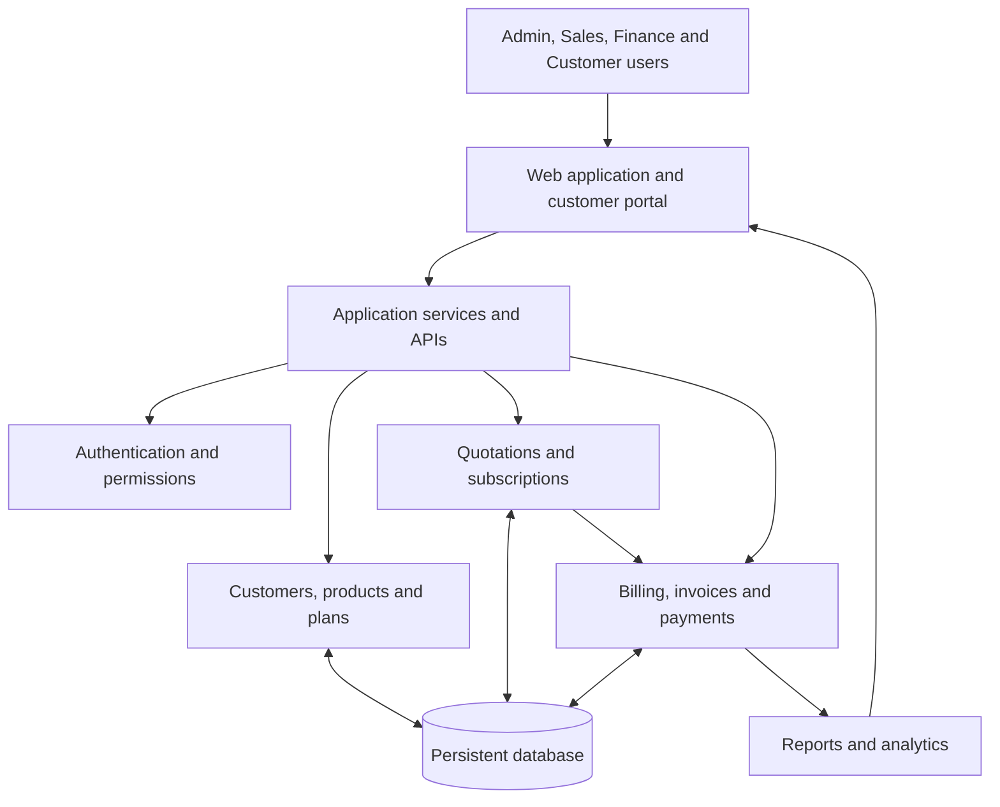
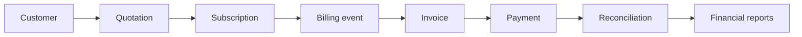

# odoo-hackathon
<div align="center">

# BRIGHTLOOP NEXUS

### One workspace. Every subscription. Complete financial clarity.

A subscription management platform for businesses to manage customers, plans, quotations, subscriptions, recurring billing, invoices, payments, and revenue operations in one place.

[Overview](#-overview) · [Features](#-features) · [Architecture](#-architecture) · [Getting started](#-getting-started) · [Team](#-team--ownership) · [Contributing](#-contributing)

<br />


</div>

---

## ✨ Overview

**Brightloop Nexus** brings the complete subscription lifecycle into a single, connected workspace.

From the first customer quotation to subscription activation, recurring invoices, payment tracking, and revenue reporting, the platform is designed to help teams manage the commercial and financial side of subscription businesses with greater visibility and control.

Instead of disconnected spreadsheets and isolated tools, Brightloop Nexus aims to provide a shared source of truth for customer, subscription, and billing information.

> **Our goal:** make subscription operations easier to understand, easier to manage, and more reliable as a business grows.

## 🚀 Features

The following areas define the project scope. Feature availability depends on the current implementation and is tracked during development.

| Area | Capabilities |
| --- | --- |
| **Customer management** | Customer profiles, contact details, billing information, search, and customer history |
| **Products and plans** | Product catalogue, subscription plans, pricing, billing intervals, and plan status |
| **Quotations** | Quotation creation, line items, discounts, expiry dates, approval, and conversion |
| **Subscriptions** | Activation, trials, renewals, upgrades, downgrades, pauses, and cancellations |
| **Billing** | Recurring billing workflows, invoice generation, billing history, and outstanding balances |
| **Invoices** | Invoice records, line items, tax breakdowns, due dates, statuses, and exports |
| **Payments** | Payment tracking, payment attempts, refunds, and reconciliation workflows |
| **Analytics** | Subscription summaries, revenue trends, payment status, and overdue balances |
| **Customer portal** | Customer access to their own subscriptions, invoices, and payment history |
| **Access control** | Authentication, role based permissions, and protected business records |

## 🧭 Why Brightloop Nexus?

Subscription operations involve more than collecting a recurring payment. Teams need to understand who the customer is, what they purchased, when the next renewal is due, which invoices remain unpaid, and how each financial event affects the business.

Brightloop Nexus is being developed around four principles:

1. **Connected workflows.** Customer, quotation, subscription, and billing records should relate to one another.
2. **Reliable financial data.** Monetary calculations belong on the backend and must preserve a clear transaction history.
3. **Useful visibility.** Dashboards should reflect actual application data rather than decorative sample numbers.
4. **Practical engineering.** The application should be maintainable, testable, responsive, and runnable in a local development environment.

## 🏗️ Architecture

Brightloop Nexus is organised into cooperating application areas. The final implementation must follow the framework and architecture already present in the repository.



### Core workflow



The diagrams describe the intended product flow. They are not a claim that every module or integration is already complete.

## 🧰 Technology stack

The exact technology stack must be confirmed from the existing source code and documented here by the team. Do not add a new framework simply to match this section.

| Layer | Project choice |
| --- | --- |
| Frontend | `Document the framework used in this repository` |
| Backend | `Document the framework or Odoo version used in this repository` |
| Database | `Document the configured database` |
| API layer | `Document REST, RPC, or the existing application interface` |
| Authentication | `Document the implemented authentication approach` |
| Testing | `Document the test framework and commands` |
| Development tools | Git, GitHub, and the tools already used by the project |

## 📁 Repository structure

The structure below is a suggested logical organisation. Keep the actual repository structure if it already exists, and update this section to match the real folders.

```text
brightloop-nexus/
│
├── frontend/                 # Web interface, if separated
├── backend/                  # Backend application, if separated
├── addons/                   # Odoo custom modules, if this is an Odoo project
├── docs/                     # Architecture, API and contribution documentation
├── tests/                    # Automated tests, if maintained at the root
├── .env.example              # Environment variable template, if applicable
├── .gitignore
└── README.md
```

Do not create both `frontend/` and `backend/` merely to match this example. Use the folders and module conventions that fit the actual project.

## ⚙️ Getting started

### Prerequisites

Install the tools required by the stack already used in this repository. These may include:

* Git
* The project's supported runtime and package manager
* The configured database
* Any framework or Odoo dependencies required by the application

Check the project documentation and dependency files for the exact versions.

### 1. Clone the repository

```bash
git clone <YOUR_GITHUB_REPOSITORY_URL>
cd <YOUR_PROJECT_DIRECTORY>
```

### 2. Configure the environment

Create your local environment file from the provided example, if the project uses one.

```bash
# Windows PowerShell
Copy-Item .env.example .env
```

Add the required local database settings and application configuration. Never commit the real `.env` file, passwords, API keys, tokens, or other secrets.

### 3. Install dependencies

Use the dependency manager and installation instructions already present in the repository.

Examples of project files to inspect include `package.json`, `requirements.txt`, `pyproject.toml`, `Pipfile`, `Gemfile`, or an Odoo configuration and addon manifest. Run only the installation command that applies to this project.

### 4. Prepare the database

Configure the local database using the project's documented setup process. Run the migrations or module update process required by the chosen framework.

### 5. Start the application

Use the development command documented by the project. The team should replace this note with the exact verified command once the application stack has been confirmed.

> **Setup note:** The repository's actual framework and commands have not been verified while preparing this README. Replace the setup placeholders with tested instructions before treating this guide as final.

## 👥 Team & ownership

Brightloop Nexus is developed collaboratively by a four person team. Each teammate owns a module while contributing to the same repository and shared application.

| Teammate | Ownership | Main responsibilities |
| --- | --- | --- |
| **Teammate 1** | Foundation and core backend | Database foundation, authentication, permissions, customers, products, plans, and shared API contracts |
| **Teammate 2** | Subscription operations | Quotations, subscription lifecycle, renewals, plan changes, and cancellations |
| **Teammate 3** | Billing and financial engine | Invoices, recurring billing, taxes, discounts, payments, refunds, reconciliation, and financial reports |
| **Teammate 4** | Frontend and integration | Design system, navigation, dashboard, customer portal, API integration, responsive UI, and end to end testing |

Module ownership does not mean separate applications. All teammates work in the same repository and coordinate changes to shared contracts.

## 🌿 Git workflow

We use feature branches and pull requests so that work can be reviewed before it reaches the shared integration branch.

### Branches

| Branch | Purpose |
| --- | --- |
| `main` | Stable project branch |
| `integration` | Combined team development branch |
| `team1/foundation` | Teammate 1 work |
| `team2/subscriptions` | Teammate 2 work |
| `team3/billing` | Teammate 3 work |
| `team4/frontend` | Teammate 4 work |

### Development flow

1. Start from the latest `integration` branch.
2. Create or switch to your assigned feature branch.
3. Make focused changes within your module.
4. Run the relevant tests and checks.
5. Commit your work with a meaningful message.
6. Push your branch to GitHub.
7. Open a pull request targeting `integration`.
8. Request a teammate review and resolve feedback.
9. Merge only after the changes have been reviewed and integration checks pass.

Example for Teammate 3:

```bash
git switch integration
git pull origin integration
git switch -c team3/billing

# Make and test your changes

git add .
git commit -m "feat: implement billing and financial engine"
git push -u origin team3/billing
```

After pushing, open a pull request from `team3/billing` into `integration`. Do not push directly to `main` or overwrite another teammate's changes.

### Integration sequence

The recommended handoff sequence is:

1. Teammate 1 establishes the foundation and publishes the shared contracts.
2. Teammate 4 can begin the design system and frontend shell while the foundation is being built.
3. Teammate 2 implements subscription workflows against the agreed contracts.
4. Teammate 3 implements billing against the agreed subscription and customer contracts.
5. Teammate 4 connects the completed APIs and finishes the integrated experience.
6. Everyone tests the complete customer to subscription to invoice to payment workflow.

Teammates may work in parallel once shared interfaces are agreed. A teammate should pull the latest `integration` branch after the preceding pull request has been merged.

## 🧪 Quality standards

Every feature should be built and reviewed against these standards:

* **Dynamic data:** normal application workflows must use the persistent database, not hardcoded JSON or frontend arrays.
* **Validation:** validate user input on the server and provide useful feedback in the interface.
* **Financial integrity:** use safe monetary representations, server side calculations, transaction boundaries, and duplicate operation protection.
* **Security:** enforce permissions on the backend and keep secrets out of source control.
* **Responsive design:** support desktop, tablet, and mobile layouts.
* **Error handling:** make loading, empty, offline, and failure states understandable.
* **Testing:** test both successful workflows and important failure cases.
* **Documentation:** keep setup instructions, API contracts, and module documentation aligned with the implementation.

## 🗺️ Roadmap

The team will update this roadmap as features are implemented and verified.

- [ ] Confirm and document the current application stack
- [ ] Establish shared database models and API contracts
- [ ] Implement authentication and role based permissions
- [ ] Complete customer, product, and plan management
- [ ] Complete quotation and subscription workflows
- [x] Implement invoice generation and recurring billing (Team 3 - Completed)
- [x] Implement payment tracking and reconciliation (Team 3 - Completed)
- [ ] Build the unified dashboard and customer portal
- [x] Add automated tests for critical workflows (Team 3 - 10/10 Passed via uv run pytest)
- [ ] Verify local setup and end to end integration
- [ ] Prepare a reliable project demonstration

## 🔐 Security

Please do not commit credentials, API keys, access tokens, production database exports, customer personal data, or private configuration files.

Use `.env.example` for variable names and safe placeholder values. Report security issues privately to the project maintainers rather than publishing sensitive details in a public issue.

## 📚 Documentation

Project documentation should live in the `docs/` directory where practical.

Recommended documents:

| Document | Purpose |
| --- | --- |
| `docs/ARCHITECTURE.md` | Application structure and module relationships |
| `docs/DATABASE.md` | Data models and relationships |
| `docs/API.md` | API routes, payloads, and response conventions |
| `docs/BILLING_ENGINE.md` | Team 3 Billing, Invoicing, Tax, Refunds, and Reconciliation |
| `docs/CONTRIBUTION.md` | Branching, reviews, and team workflow |
| `docs/LOCAL_SETUP.md` | Verified local installation and run instructions |

## 🤝 Contributing

Contributions from all four teammates are part of one shared product. Before changing a shared model, API contract, dependency, or global component, coordinate with the teammates who use it.

Keep pull requests focused, explain why a change is needed, and include the tests or manual checks performed. Avoid unrelated formatting changes and do not commit generated files or local environment secrets.

## 📄 License

No license has been specified yet. Add a `LICENSE` file and update this section once the team has agreed on the project's distribution and usage terms.

---

<div align="center">

**Built collaboratively by Team Brightloop.**

*Turning subscription complexity into operational clarity.*

</div>
