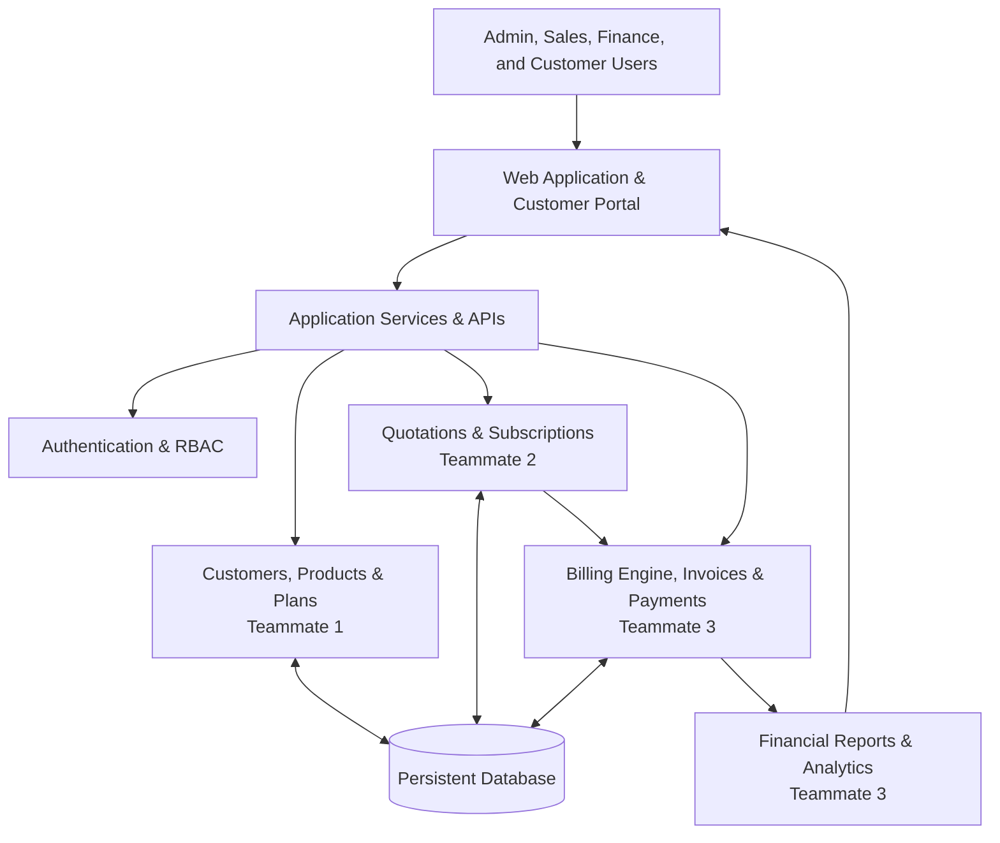
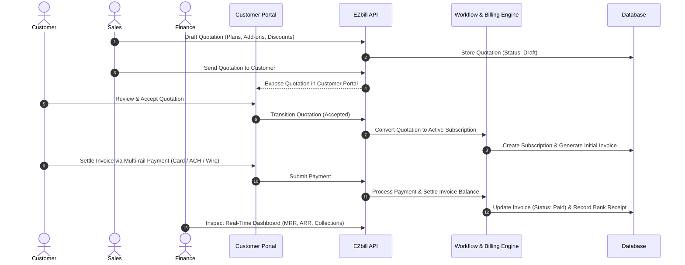

<div align="center">

# EZBILL

### One workspace. Every subscription. Complete financial clarity.

A subscription management platform for businesses to manage customers, plans, quotations, subscriptions, recurring billing, invoices, payments, and revenue operations in one place.

[Overview](#-overview) · [Features](#-features) · [Architecture](#-architecture) · [Getting Started](#-getting-started) · [Team & Ownership](#-team--ownership) · [Documentation](#-documentation) · [Contributing](#-contributing)

<br />


</div>

---

## ✨ Overview

**EZbill** brings the complete subscription lifecycle into a single, connected workspace.

From the first customer quotation to subscription activation, recurring invoices, payment tracking, and revenue reporting, the platform is designed to help teams manage the commercial and financial side of subscription businesses with greater visibility and control.

Instead of disconnected spreadsheets and isolated tools, EZbill provides a shared source of truth for customer, subscription, and billing information.

> **Our goal:** Make subscription operations easier to understand, easier to manage, and more reliable as a business grows.

---

## 🚀 Features

The following areas define the project scope. Feature availability is tracked collaboratively across all four teams:

| Area | Capabilities |
| --- | --- |
| **Customer Management** | Customer profiles, contact details, billing information, search, and customer history |
| **Products & Plans** | Product catalogue, subscription plans, pricing tiers, billing intervals, and active status |
| **Quotations** | Quotation creation, line items, discounts, expiry dates, approval, and subscription conversion |
| **Subscriptions** | Activation, trials, renewals, upgrades, downgrades, pauses, and cancellations |
| **Billing Engine** | Centralized billing engine, recurring billing cycles, idempotent invoice generation, and balance tracking |
| **Invoices** | Sequential numbering (`INV-2026-XXX`), line items, GST breakdown (CGST/SGST/IGST), due dates, and status transitions |
| **Payments** | Payment tracking, partial payments, simulated payment gateways, and duplicate transaction detection |
| **Reconciliation** | Automated audit comparing recorded payments against invoices, detecting over/underpayments and discrepancies |
| **Refunds** | Multi-step refund workflow (`requested` → `approved` → `completed`), balance replenishment, and refundable limits |
| **Analytics & Reports** | Real-time MRR, ARR, Accounts Receivable (AR), overdue balance exposure, and collection efficiency |
| **Customer Portal** | Customer-facing self-service view of subscriptions, proration plan switching, open invoices, and cleared payments |
| **Unified Dashboard** | Central command center integrating KPIs across all modules with real-time audit logging |
| **Access Control** | Authentication, role-based permissions (Admin, Finance, Sales, Customer), and protected business records |

---

## 🧭 Why EZbill?

Subscription operations involve more than collecting a recurring payment. Teams need to understand who the customer is, what they purchased, when the next renewal is due, which invoices remain unpaid, and how each financial event affects the business.

EZbill is built around four principles:

1. **Connected Workflows:** Customer, quotation, subscription, and billing records relate directly to one another.
2. **Reliable Financial Data:** Monetary calculations happen on the backend using high-precision Decimal and minor-unit representations, preserving transaction history.
3. **Useful Visibility:** Dashboards reflect actual application records rather than decorative sample data.
4. **Practical Engineering:** The application is maintainable, thoroughly tested, and runnable locally with clear commands.

---

## 🏗️ Architecture

EZbill is organised into cooperating modules:



### Core Workflow



---

## 💻 Tech Stack

- **Frontend & Web Shell:** React 19, TypeScript, Vite, Tailwind CSS, Lucide Icons, Motion
- **Application Server:** Node.js, Express, tsx
- **Data & Storage:** Persistent SQLite Engine & JSON Storage with ACID transactions
- **Billing Engine Backend:** Python, Decimal arithmetic, Pytest (via `uv`)
- **Testing:** Node Native Test Runner, Pytest, End-to-End Integration Test Suite

---

## 🏁 Getting Started

### Prerequisites

- **Node.js** (v18+ recommended)
- **Python** (v3.10+ recommended)
- **uv** package manager (`pip install uv` or via standalone installer)

### 1. Run the Frontend & Express API Server

```powershell
cd bright_loop_frontend
npm install --legacy-peer-deps
npm run dev
```

The application runs on `http://localhost:3000`.

### 2. Run the Foundation Test Suite (Team 1)

```powershell
cd bright_loop_frontend
npm run test:foundation
```
*Executes 18 automated tests covering relational migrations, ACID transactions, PBKDF2 cryptography, session tokens, RBAC permissions, customer management, plan versioning, and multi-tenancy.*

### 3. Run the Workflow Engine Test Suite (Team 2 & Team 4)

```powershell
cd bright_loop_frontend
npm test
```
*Executes 33 automated tests covering quotation calculations, state transitions, revisions, subscriptions lifecycle, upgrades/downgrades with proration, renewals, cancellations, and full end-to-end integration.*

Run the complete test suite across all subsystems:
```powershell
npm run test:all
```
*Executes all automated tests covering foundation, workflow engines, E2E integration, financial metrics, and pricing algorithms.*

### 4. Run the Billing Engine Test Suite (Team 3 with `uv`)

```powershell
cd billing_engine
uv run pytest
```

---

## 👥 Team & Ownership

| Teammate | Focus Area | Responsibilities | Working Branch |
| --- | --- | --- | --- |
| **Teammate 1** | Foundation & Core | Database foundation, authentication, users, customers, products, plans | `team1/foundation` |
| **Teammate 2** | Workflows | Quotations, subscriptions, renewals, cancellations, lifecycle states | `team2/workflow` |
| **Teammate 3** | Billing & Financials | Billing engine, GST taxes, discounts, invoices, payments, refunds, reconciliation | `team3/billing` |
| **Teammate 4** | Frontend & Experience | UI shell, unified dashboard, customer portal, navigation, design system | `team4/frontend` |

---

## 📋 Git Workflow

- Work strictly on your designated team branch (e.g. `team4/frontend`).
- Do not commit directly to `main`.
- Make small, incremental, meaningful commits.
- Push changes to your branch and create pull requests targeting `integration`.

---

## 🧪 Quality Standards

Every feature is developed and verified against these standards:

- **Dynamic Data:** Application workflows use persistent database records rather than decorative static numbers.
- **Financial Precision:** Strict `Decimal` and integer minor-unit arithmetic prevents floating-point inaccuracies.
- **Idempotency:** Billing cycles utilize unique period keys to prevent duplicate invoices.
- **Security:** Permissions enforced on backend; secrets stored in environment variables.
- **Testing:** Automated tests cover calculation edge cases, discount caps, refunds, and reconciliation.

---

## 🗺️ Roadmap

- [x] Confirm and document the application stack
- [x] Complete foundation, auth, database, customer, product, and plan management (`team1/foundation` - Completed)
- [x] Implement persistent relational database architecture and migration runner (`team1/foundation` - Completed)
- [x] Implement PBKDF2 salted password hashing, session tokens, and RBAC authorization (`team1/foundation` - Completed)
- [x] Implement customer lifecycle management with safe archival and search (`team1/foundation` - Completed)
- [x] Implement product catalog and subscription plan pricing with versioning (`team1/foundation` - Completed)
- [x] Add automated test suite with `npm run test:foundation` (`team1/foundation` - 18/18 Passed)
- [x] Complete quotation and subscription workflows (`team2/workflow` - Completed)
- [x] Implement quotation creation, line item calculations, and revision tracking (`team2/workflow` - Completed)
- [x] Implement safe idempotent quotation-to-subscription conversion (`team2/workflow` - Completed)
- [x] Implement subscription lifecycle state machine and trial periods (`team2/workflow` - Completed)
- [x] Implement mid-cycle plan upgrades/downgrades with mathematical proration (`team2/workflow` - Completed)
- [x] Implement automated renewal engine and billing period key idempotency (`team2/workflow` - Completed)
- [x] Implement immediate vs end-of-period cancellations (`team2/workflow` - Completed)
- [x] Add automated test suite with `npm test` (`team2/workflow` - 23/23 Passed)
- [x] Implement invoice generation and recurring billing (`team3/billing` - Completed)
- [x] Implement GST tax calculation engine (`team3/billing` - Completed)
- [x] Implement discount validation and cap rules (`team3/billing` - Completed)
- [x] Implement payment tracking, partial settlement, and simulation (`team3/billing` - Completed)
- [x] Implement refund lifecycle and balance enforcement (`team3/billing` - Completed)
- [x] Implement payment reconciliation audit (`team3/billing` - Completed)
- [x] Add automated test suite with `uv run pytest` (`team3/billing` - 10/10 Passed)
- [x] Build unified dashboard and customer portal integration (`team4/frontend` - Completed)
- [x] Final end-to-end integration test (`team4/frontend` - 42/42 Tests Passed)

---

## 🔐 Security

- Never commit credentials, private API keys, or personal customer data.
- Use `.env.example` for environment variable templates.
- Financial transactions are signed and simulated securely without storing sensitive cardholder details.

---

## 📄 Documentation

- [Architecture Guide](docs/ARCHITECTURE.md)
- [Database Models & Schema](docs/DATABASE.md)
- [API Reference](docs/API.md)
- [Contribution Guidelines](docs/CONTRIBUTION.md)
