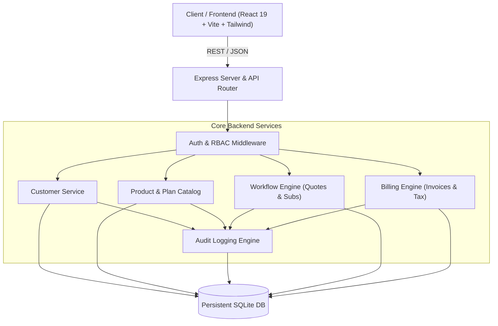

# EZbill System Architecture

## 1. System Overview

**EZbill** is a modular subscription management platform engineered to deliver end-to-end visibility across customers, plans, quotes, subscriptions, invoices, and payments. The architecture is designed around high cohesiveness, low coupling, persistent database transactions, and deterministic offline local operation.

---

## 2. Team Responsibility Matrix

| Module | Team / Owner | Responsibilities & Boundaries |
| :--- | :--- | :--- |
| **Foundation & Architecture** | **Team 1 (team1/foundation)** | Shared backend runtime, database schema & migrations, Auth & RBAC, Organizations, Customers, Products, Subscription Plans, Audit Logging, API Conventions, Offline guarantees. |
| **Workflow Engine** | **Team 2 (team2/workflow)** | Quotation creation & revisions, Quotation approval to Subscription transition, Subscription state machine, trial periods, proration calculations, renewal dispatching. |
| **Billing Engine** | **Team 3 (team3/billing)** | Recurring billing cycles, invoice generation, GST tax calculation (CGST/SGST/IGST), discount codes, payment recording, simulation gateway, reconciliation, refunds. |
| **Frontend Platform** | **Team 4 (team4/frontend)** | React 19 single-page application, interactive dashboards, customer & admin views, quotation builder, invoice management, analytics visualization. |

---

## 3. Logical Modules & Integration Contracts

The platform comprises 12 interconnected business modules:

1. **Authentication & Authorization:** Secure session tokens, password hashing, organization scoping, role-based access control (Admin, Finance, Sales, Support, Customer).
2. **User & Organization Management:** Multi-tenant workspaces, user accounts, and memberships.
3. **Customer Management:** Full lifecycle customer records, address, contact details, tax identifiers, and safe archival.
4. **Product Catalog:** Products and service definitions.
5. **Subscription Plan Management:** Plans, billing intervals (monthly, quarterly, annual), pricing in minor units (integer cents), feature limits, and versioning.
6. **Quotation Management:** Line items, discounts, expiration, and sales team negotiation.
7. **Subscription Lifecycle:** Active, trialing, paused, canceled, past-due states, proration, and automated term renewal.
8. **Billing & Invoicing:** Sequential invoice generation (`INV-YYYY-XXX`), balance tracking, itemization, and tax calculation.
9. **Payment Tracking & Reconciliation:** Multi-method payments (card, wire, ACH, simulation), discrepancy detection, and refund processing.
10. **Reporting & Analytics:** Real-time MRR, ARR, Accounts Receivable exposure, and collection metrics.
11. **Audit Logging:** Immutable audit ledger tracking actor, timestamp, action type, and before/after context.
12. **Customer Self-Service Portal:** Restricted tenant view allowing end-customers to inspect subscriptions, pay open invoices, and view receipts.

---

## 4. Design Principles & Non-Negotiables

1. **Relational Data Integrity:** Foreign key constraints, indexed lookup columns, cascading soft-deletes where appropriate, and transactional safety.
2. **Financial Precision:** All monetary amounts are handled strictly in integer minor units (e.g., cents, paise) to completely prevent IEEE 754 floating-point inaccuracies.
3. **Local & Offline Guarantee:** Zero mandatory external cloud dependencies. Evaluators can clone the repo and run the entire suite locally with persistent SQLite storage without requiring cloud logins or paid API keys.
4. **Fail-Closed Security:** Backend enforces all RBAC policies and organization boundaries. Frontend route guards are purely for UX; the API never trusts client-side assertions.
5. **Immutability of Historical Transactions:** Modifying a plan's price never alters existing subscriptions or past invoices. Historical records preserve the exact commercial terms applicable at the time of transaction.
