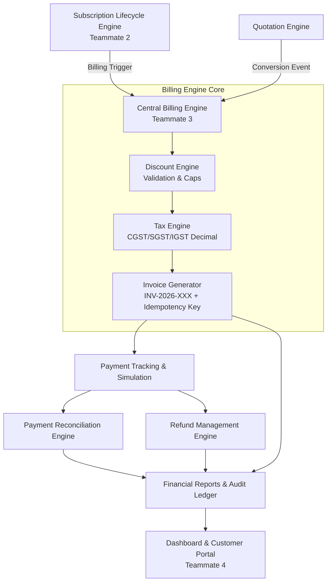

# Brightloop Nexus — Billing & Financial Management Module
**Team 3: Billing & Financial Engine Documentation**

---

## 1. Billing Architecture

The Billing and Financial Management Module provides enterprise-grade subscription billing, accounts receivable ledger tracking, tax calculation (Indian GST compliant), discount enforcement, payment reconciliation, and real-time revenue analytics.



### Core Design Principles
1. **Precision & Consistency**: All monetary calculations use `Decimal` with `ROUND_HALF_UP` (in Python) and exact minor integer units (cents/paise in TypeScript) to prevent IEEE 754 floating-point inaccuracies.
2. **Server-Side Authority**: Clients never calculate amounts or taxes. The backend is the sole source of financial truth.
3. **Idempotency & Duplicate Prevention**: Invoices generated from recurring cycles utilize deterministic `billing_period_key` attributes (e.g., `sub-201_2026-10`), strictly rejecting repeat billing requests.
4. **Separation of Obligations from Cash**: Differentiates gross invoiced accounts receivable from cleared, realized cash receipts.

---

## 2. Database Models & Schema

### Invoices (`Invoice` / `ExtendedInvoice`)
- `id` (string, PK): Unique record identifier (`inv-...`)
- `invoice_number` (string, unique): Safe sequential number (`INV-2026-004`)
- `customer_id` (string, FK): Customer account reference
- `customer_name` (string): Customer snapshot at invoice generation
- `subscription_id` (string, optional FK): Associated recurring subscription
- `quotation_id` (string, optional FK): Quotation converted into this invoice
- `items` (array): Line items with unit price, qty, discounts, and itemized tax breakdowns
- `subtotal` (decimal): Pre-discount, pre-tax base amount
- `total_discount` (decimal): Total applied promotional discount
- `total_tax` (decimal): Aggregate tax amount
- `total` (decimal): Final payable balance
- `amount_paid` (decimal): Cumulative settled payment amount
- `amount_due` (decimal): Outstanding receivable balance
- `currency` (string): Standard currency code (e.g. `USD`, `INR`)
- `status` (enum): `draft`, `issued`, `unpaid`, `partially_paid`, `paid`, `overdue`, `void`, `uncollectible`
- `issue_date` (ISO timestamp): Invoice issue date
- `due_date` (ISO timestamp): Net payment due date
- `paid_at` (ISO timestamp, optional): Settlement timestamp
- `tax_mode` (enum): `intra_state`, `inter_state`, `none`
- `discount_code` (string, optional): Applied promotional code
- `billing_period_key` (string, optional unique): Idempotency key for recurring periods

### Payments (`Payment`)
- `id` (string, PK): `pay-...`
- `payment_number` (string, unique): `PAY-2026-003`
- `invoice_id` (string, FK): Target invoice
- `invoice_number` (string): Human-readable invoice reference
- `customer_id` (string, FK): Account reference
- `amount` (decimal): Cleared payment amount
- `currency` (string): Payment currency (must match invoice currency)
- `method` (enum): `card`, `wire`, `ach`, `upi`, `bank_transfer`, `simulation`
- `status` (enum): `pending`, `succeeded`, `failed`, `refunded`, `partially_refunded`
- `is_simulated` (boolean): Explicit flag for simulated demonstration transactions
- `transaction_ref` (string, unique): External gateway or simulation reference
- `created_at` (ISO timestamp): Transaction timestamp

### Refunds (`Refund`)
- `id` (string, PK): `ref-...`
- `refund_number` (string, unique): `REF-2026-001`
- `payment_id` (string, FK): Original payment reference
- `payment_number` (string): Payment sequence reference
- `invoice_id` (string, FK): Originating invoice
- `amount` (decimal): Refunded amount
- `reason` (string): Justification
- `status` (enum): `requested`, `approved`, `completed`, `rejected`
- `is_simulated` (boolean): Simulated or live gateway refund
- `requested_at` / `completed_at` (ISO timestamps)

### Tax Rules (`TaxRule`)
- `id` (string, PK): `tax-...`
- `name` (string): Display label (e.g., `CGST @ 9%`)
- `type` (enum): `percentage`, `fixed`
- `rate` (decimal): Percentage rate or fixed amount
- `category` (enum): `CGST`, `SGST`, `IGST`, `VAT`, `CUSTOM`
- `region` (string): Jurisdictional code (e.g. `IN`, `IN-INTER`)
- `active` (boolean): State of enforcement

### Discounts (`Discount`)
- `id` (string, PK): `disc-...`
- `code` (string, unique): Promo code (`LAUNCH20`, `FLAT500`)
- `type` (enum): `percentage`, `fixed`
- `value` (decimal): Percentage rate or flat amount
- `max_discount_amount` (decimal, optional): Cap limit for percentage discounts
- `valid_from` / `valid_until` (ISO timestamps)
- `max_usages` / `current_usages` (integer): Usage limits
- `eligible_plan_ids` (array): Restricted tiers or `['all']`
- `min_order_amount` (decimal): Threshold required for redemption

---

## 3. Financial Calculation Rules

### Invoice Calculations
1. **Line Subtotal**:
   $$\text{Subtotal} = \text{Unit Price} \times \text{Quantity}$$
2. **Discount Allocation**:
   - For percentage: $\min\left(\frac{\text{Subtotal} \times \text{Discount Value}}{100}, \text{Max Cap}\right)$
   - For fixed: $\min(\text{Discount Value}, \text{Subtotal})$
   - Applied discount cannot reduce taxable base below zero.
3. **Taxable Base**:
   $$\text{Taxable Amount} = \text{Subtotal} - \text{Discount}$$
4. **Tax Calculation (Indian GST Norms)**:
   - Intra-state transaction:
     $$\text{CGST} = \text{round}\left(\frac{\text{Taxable Amount} \times 9}{100}\right)$$
     $$\text{SGST} = \text{round}\left(\frac{\text{Taxable Amount} \times 9}{100}\right)$$
   - Inter-state transaction:
     $$\text{IGST} = \text{round}\left(\frac{\text{Taxable Amount} \times 18}{100}\right)$$
5. **Grand Total**:
   $$\text{Total Amount} = \text{Taxable Amount} + \text{Total Taxes}$$
6. **Outstanding Due**:
   $$\text{Amount Due} = \text{Total Amount} - \text{Amount Paid}$$

---

## 4. Workflows

### Recurring Billing Workflow
1. The scheduler queries subscriptions where `status == 'active'`, `auto_renew == true`, and `next_billing_date <= now`.
2. Computes the deterministic `billing_period_key` (e.g., `sub-201_2026-11`).
3. Searches database for existing invoices with this key. If found, skips generation and avoids double-billing.
4. Generates new invoice with sequential `invoice_number`, attaches tax breakdown, and sets due date.
5. Advances subscription's `current_period_start`, `current_period_end`, and `next_billing_date`.

### Payment & Partial Settlement
1. Payment record verifies invoice exists, is not void, and amount > 0.
2. Succeeded payment increments invoice `amount_paid` and deducts from `amount_due`.
3. If `amount_due == 0`, status becomes `paid`.
4. If `0 < amount_due < total`, status becomes `partially_paid`.
5. Logs activity for audit trails.

### Refund Workflow
1. Validates payment is in `succeeded` or `partially_refunded` state.
2. Checks cumulative existing refunds against the payment amount.
3. Transitions through `requested` $\rightarrow$ `approved` $\rightarrow$ `completed`.
4. Upon completion:
   - Deducts refunded amount from invoice `amount_paid`.
   - Restores balance in invoice `amount_due`.
   - Reverts invoice status from `paid` to `unpaid` / `partially_paid`.
   - Updates payment status to `partially_refunded` or `refunded`.

### Payment Reconciliation
The reconciliation engine runs an automated audit across all invoices and transactions to detect:
- Fully paid invoices vs. partially settled invoices.
- Overpayments (cumulative payments > invoice total).
- Underpayments (settlement deficit).
- Duplicate transaction references across distinct payments.
- Unmatched payments without valid invoice associations.
- Currency mismatches between invoices and payments.
- Overdue receivables exceeding credit terms.

---

## 5. API Reference

| Endpoint | Method | Description |
| --- | --- | --- |
| `/api/billing/calculate` | `POST` | Preview billing, taxes, and discounts prior to invoice creation |
| `/api/billing/invoices` | `POST` | Generate authoritative invoice with tax breakdowns |
| `/api/billing/invoices/:id` | `GET` | Retrieve invoice with associated payments and refunds |
| `/api/billing/invoices/:id/void` | `PUT` | Void an unpaid invoice |
| `/api/billing/payments` | `POST` | Record payment (supports partial payments & simulations) |
| `/api/billing/payments` | `GET` | List filtered payment records |
| `/api/billing/refunds` | `POST` | Request refund for a payment |
| `/api/billing/refunds/:id/approve` | `PUT` | Approve requested refund |
| `/api/billing/refunds/:id/complete` | `PUT` | Complete approved refund and update balances |
| `/api/billing/refunds/:id/reject` | `PUT` | Reject refund request |
| `/api/billing/refunds` | `GET` | List refund audit records |
| `/api/billing/recurring/run` | `POST` | Trigger automated recurring billing cycle |
| `/api/billing/recurring/upcoming` | `GET` | Retrieve upcoming renewals in the next 30 days |
| `/api/billing/reconciliation/run` | `POST` | Run discrepancy reconciliation audit |
| `/api/billing/reconciliation` | `GET` | Reconciliation audit history |
| `/api/billing/tax-rules` | `GET`, `POST` | Manage configurable tax rules |
| `/api/billing/discounts` | `GET`, `POST` | Manage promotional discount codes |
| `/api/billing/discounts/validate`| `POST` | Validate discount code applicability |
| `/api/billing/reports/summary` | `GET` | Authoritative financial metrics (MRR, ARR, AR, efficiency) |
| `/api/billing/reports/outstanding`| `GET` | Aged accounts receivable report |

---

## 6. Local Development & Testing Instructions

### Run Python Test Suite (with `uv`)
```powershell
# Navigate to billing engine directory
cd C:\Users\Admin1\Desktop\odoo\billing_engine

# Run full automated test suite using uv
uv run pytest
```

### Run Frontend Application (with Vite & Express)
```powershell
# Navigate to frontend directory
cd C:\Users\Admin1\Desktop\odoo\bright_loop_frontend

# Install dependencies if needed
npm install

# Start development server
npm run dev
```

---

## 7. Known Boundaries & Teammate Integration
- **Teammate 1 (Foundation)**: Provides authentication, user roles, customer profiles, product catalogue, and base database schemas.
- **Teammate 2 (Workflow & Subscriptions)**: Submits recurring billing requests to `/api/billing/recurring/run` and quotation conversion events.
- **Teammate 3 (Billing & Financial Engine - Current)**: Processes all financial operations, guarantees ledger consistency, tax breakdowns, discount limits, refunds, and reconciliation.
- **Teammate 4 (Frontend & Portal)**: Consumes `api.billing.*` methods from `src/api/client.ts` to display invoices, cleared receipts, aging reports, and reconciliation dashboards.
