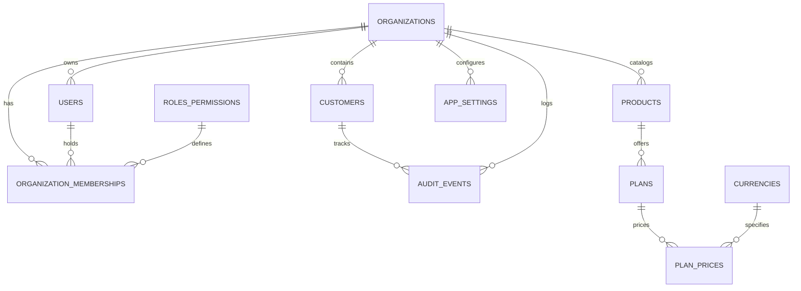

# EZbill Database Schema & Architecture

## 1. Relational Database Design

EZbill uses a normalized relational database design engineered for ACID transaction compliance, strict multi-tenancy, and financial auditability. The local default engine is **SQLite** (file-based, zero configuration required for local evaluation), with schema DDL fully portable to PostgreSQL.

---

## 2. Core Foundation Entities (Team 1)

### 2.1 `organizations`
Stores tenant workspaces / legal entities running the billing system.
- `id` (VARCHAR(36), PK): UUID or slug (e.g. `org-ezbill-primary`).
- `name` (VARCHAR(255), NOT NULL): Legal organization name.
- `slug` (VARCHAR(100), UNIQUE, NOT NULL): URL-safe identifier.
- `currency` (VARCHAR(3), DEFAULT 'USD'): Primary reporting currency.
- `timezone` (VARCHAR(50), DEFAULT 'UTC'): Organization default timezone.
- `created_at` (DATETIME, NOT NULL).
- `updated_at` (DATETIME, NOT NULL).

### 2.2 `users`
Global or organization-scoped system users.
- `id` (VARCHAR(36), PK): Unique user ID (e.g. `usr-1`).
- `email` (VARCHAR(255), UNIQUE, NOT NULL): User login email.
- `password_hash` (TEXT, NOT NULL): Salted password hash (PBKDF2/Argon2/bcrypt).
- `name` (VARCHAR(255), NOT NULL): Full name of the user.
- `is_active` (BOOLEAN, DEFAULT 1): Active account indicator.
- `created_at` (DATETIME, NOT NULL).
- `updated_at` (DATETIME, NOT NULL).

### 2.3 `roles_permissions`
Defines available system roles and granular permission sets.
- `id` (VARCHAR(36), PK): Identifier (e.g. `role-admin`, `role-finance`).
- `name` (VARCHAR(50), UNIQUE, NOT NULL): `admin`, `finance`, `sales`, `support`, `customer`.
- `description` (TEXT): Description of permissions.
- `permissions` (TEXT, NOT NULL): JSON-encoded array of allowed capabilities.

### 2.4 `organization_memberships`
Links users to organizations with a specific assigned role.
- `id` (VARCHAR(36), PK): Membership ID.
- `organization_id` (VARCHAR(36), FK -> `organizations.id` ON DELETE CASCADE).
- `user_id` (VARCHAR(36), FK -> `users.id` ON DELETE CASCADE).
- `role_id` (VARCHAR(36), FK -> `roles_permissions.id`).
- `customer_id` (VARCHAR(36), FK -> `customers.id` NULLABLE): Attached if user is a portal customer.
- `created_at` (DATETIME, NOT NULL).
- `UNIQUE(organization_id, user_id)`

### 2.5 `customers`
Customer accounts and billing contacts.
- `id` (VARCHAR(36), PK): Customer identifier (e.g. `cust-1`).
- `organization_id` (VARCHAR(36), FK -> `organizations.id` ON DELETE RESTRICT).
- `name` (VARCHAR(255), NOT NULL): Primary contact person.
- `company` (VARCHAR(255), NOT NULL): Business/Legal name.
- `email` (VARCHAR(255), NOT NULL): Billing and notification email.
- `phone` (VARCHAR(50)): Phone number with country code.
- `address` (TEXT): Physical/Billing street address.
- `country` (VARCHAR(2), DEFAULT 'US'): ISO 3166-1 alpha-2 country code.
- `tax_id` (VARCHAR(50)): Tax ID / GSTIN / VAT number.
- `currency_preference` (VARCHAR(3), DEFAULT 'USD'): Preferred invoicing currency.
- `status` (VARCHAR(20), DEFAULT 'active'): `active`, `lead`, `inactive`, `archived`.
- `created_at` (DATETIME, NOT NULL).
- `updated_at` (DATETIME, NOT NULL).
- `INDEX(organization_id, email)`
- `INDEX(organization_id, status)`

### 2.6 `products`
The product or service catalog.
- `id` (VARCHAR(36), PK): Product identifier (e.g. `prod-1`).
- `organization_id` (VARCHAR(36), FK -> `organizations.id` ON DELETE RESTRICT).
- `name` (VARCHAR(255), NOT NULL): Product display name.
- `description` (TEXT): Product overview and documentation.
- `active` (BOOLEAN, DEFAULT 1): Catalog visibility flag.
- `created_at` (DATETIME, NOT NULL).
- `updated_at` (DATETIME, NOT NULL).

### 2.7 `subscription_plans` (and `plan_prices`)
Tiers, recurring intervals, and commercial constraints.
- `id` (VARCHAR(36), PK): Plan identifier (e.g. `plan-starter`).
- `product_id` (VARCHAR(36), FK -> `products.id` ON DELETE RESTRICT).
- `name` (VARCHAR(255), NOT NULL): Plan title (e.g. "Growth Plan").
- `description` (TEXT): Plan marketing summary.
- `billing_interval` (VARCHAR(20), NOT NULL): `monthly`, `quarterly`, `annual`.
- `price` (INTEGER, NOT NULL): **Monetary price in minor units (integer cents, e.g. 2400 = $24.00)**.
- `currency` (VARCHAR(3), DEFAULT 'USD'): ISO 4217 currency code.
- `trial_duration_days` (INTEGER, DEFAULT 0): Free trial days.
- `features` (TEXT): JSON-encoded array of feature badges and limits.
- `active` (BOOLEAN, DEFAULT 1): Active for new subscriptions.
- `version` (INTEGER, DEFAULT 1): Schema version to preserve historical subscription contracts.
- `created_at` (DATETIME, NOT NULL).
- `updated_at` (DATETIME, NOT NULL).

### 2.8 `currencies`
Supported system currencies and decimal exponent rules.
- `code` (VARCHAR(3), PK): `USD`, `EUR`, `GBP`, `INR`, etc.
- `symbol` (VARCHAR(10), NOT NULL): `$`, `€`, `£`, `₹`.
- `minor_unit_factor` (INTEGER, DEFAULT 100): Minor unit multiplier (100 for cents, 1 for JPY).
- `active` (BOOLEAN, DEFAULT 1).

### 2.9 `audit_events`
Immutable security and administrative compliance ledger.
- `id` (VARCHAR(36), PK): Event identifier (e.g. `act-1730000000`).
- `organization_id` (VARCHAR(36), FK -> `organizations.id`).
- `timestamp` (DATETIME, NOT NULL).
- `type` (VARCHAR(100), NOT NULL): Event code (`user_login`, `customer_created`, etc.).
- `description` (TEXT, NOT NULL): Human-readable activity narrative.
- `actor` (VARCHAR(255), NOT NULL): User name, email, or 'System'.
- `ip_address` (VARCHAR(45)): Request originating IP.
- `metadata` (TEXT): JSON payload of entity changes or before/after state.

### 2.10 `app_settings`
Configurable operational policies per organization.
- `id` (VARCHAR(36), PK).
- `organization_id` (VARCHAR(36), FK -> `organizations.id`).
- `key` (VARCHAR(100), NOT NULL).
- `value` (TEXT, NOT NULL): JSON value or setting string.
- `UNIQUE(organization_id, key)`

---

## 3. Financial Integrity & Deletion Rules

1. **Monetary Storage:** Zero floating-point columns. All columns storing money (`price`, `subtotal`, `tax`, `total`, `amount_paid`, `amount_due`) use 64-bit integer minor units.
2. **Safe Archival Policy (Soft Delete):** Customer records linked to historical quotations, subscriptions, or invoices are **never hard-deleted**. Invoking a delete operation sets `status = 'archived'`.
3. **Foreign Key Enforcement:** Foreign key constraints are enforced with `PRAGMA foreign_keys = ON;` in SQLite. Hard deletion of products or plans with active subscriptions is blocked by `ON DELETE RESTRICT`.
