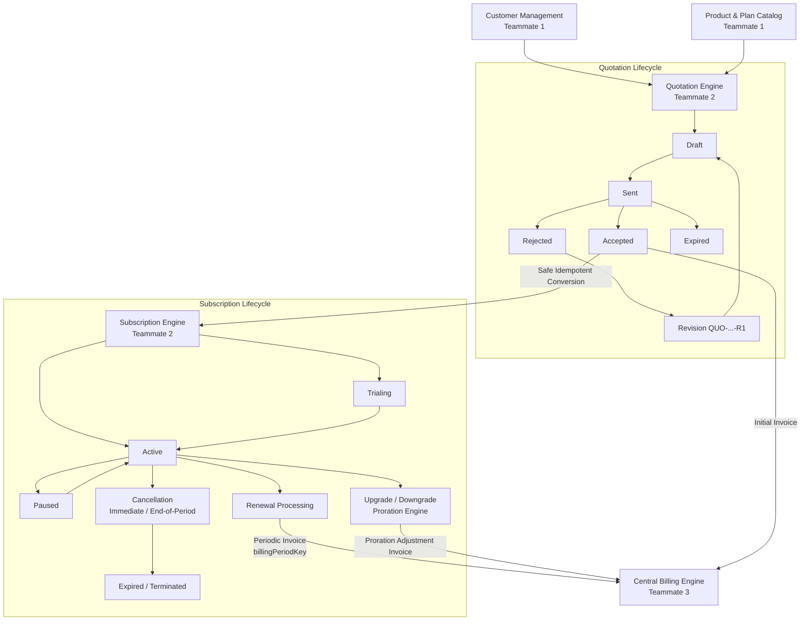

# EZbill — Quotation & Subscription Lifecycle Workflow Module
**Team 2: Workflow & Subscription Lifecycle Engine Documentation**

---

## 1. Workflow Architecture & Overview

The **Quotation & Subscription Lifecycle Module** serves as the operational bridge connecting Teammate 1's foundational Customer and Plan records with Teammate 3's authoritative Billing Engine and Teammate 4's user interface.

It guarantees strict business logic enforcement:
- **Server-Side Financial Integrity**: Quotation totals, line items, item discounts, and tax amounts are authoritative and calculated exclusively on the backend.
- **Formal State Machines**: Enforces valid forward state transitions for both quotations and subscriptions. Terminal or expired states cannot be bypassed.
- **Revision Lineage**: Rejected or revised quotations generate traceable child revisions (`QUO-2026-001-R1`) while preserving historical terms.
- **Idempotent Conversions**: Accepted quotations convert safely into subscriptions and initial invoices without risk of duplicate creation on network retries.
- **Deterministic Billing Coordination**: Subscriptions advance their lifecycle and invoke Teammate 3's billing module using deterministic `billingPeriodKey` identifiers to eliminate duplicate invoicing.
- **Mathematical Proration**: Mid-cycle upgrades and downgrades compute precise, auditable unearned credits and prorated charges.



---

## 2. Quotation Engine

### Quotation Data Model
- `id` (string, PK): System identifier (e.g., `quo-abc-123`).
- `quotation_number` (string, unique): Human-readable sequence number (e.g., `QUO-2026-001`).
- `revision_number` (number): Monotonically increasing revision counter (`0` for initial, `1` for R1, etc.).
- `customer_id` (string, FK): Customer reference.
- `customer_name` (string): Snapshot of customer name.
- `customer_email` (string): Snapshot of customer email.
- `status` (enum): `draft` | `sent` | `accepted` | `rejected` | `expired` | `converted`.
- `items` (array): Line items representing products or subscription plans.
  - `product_id` / `plan_id`: Item identifier.
  - `description`: Item description.
  - `quantity`: Positive integer.
  - `unit_price`: Base unit price in currency units.
  - `discount_type`: `percentage` | `fixed`.
  - `discount_value`: Applied discount value.
  - `tax_rate`: Percentage tax rate (e.g., 18 for 18% GST).
  - `subtotal`: `quantity * unit_price`.
  - `discount_amount`: Calculated discount amount.
  - `taxable_amount`: `subtotal - discount_amount`.
  - `tax_amount`: Calculated tax amount.
  - `total`: Final payable for this line item.
- `subtotal` (number): Pre-discount, pre-tax total of all items.
- `total_discount` (number): Sum of line-item discounts.
- `total_tax` (number): Sum of line-item taxes.
- `total` (number): Final payable quotation balance (`subtotal - total_discount + total_tax`).
- `currency` (string): Standard currency code (e.g. `USD`, `INR`).
- `terms_and_conditions` (string): Commercial and legal agreement terms.
- `notes` (string): Customer-facing or internal remarks.
- `expiration_date` (ISO string): Date on which the quotation auto-expires.
- `converted_subscription_id` (string, optional FK): Tracing reference if converted.
- `converted_invoice_id` (string, optional FK): Tracing reference to created invoice.
- `created_by` (string): User ID or email of sales representative.
- `created_at` / `updated_at` (ISO strings): Audit timestamps.

### Server-Side Calculations
Monetary integrity is enforced using integer-minor-unit rounding (`roundToCents(n) = Math.round(n * 100) / 100`):
1. **Item Subtotal**: $\text{subtotal} = \text{roundToCents}(\text{quantity} \times \text{unit\_price})$
2. **Item Discount**:
   - Fixed: $\min(\text{discount\_value}, \text{subtotal})$
   - Percentage: $\text{roundToCents}\left(\text{subtotal} \times \frac{\text{discount\_value}}{100}\right)$
3. **Item Tax**:
   - $\text{taxable} = \text{subtotal} - \text{discount}$
   - $\text{tax} = \text{roundToCents}\left(\text{taxable} \times \frac{\text{tax\_rate}}{100}\right)$
4. **Item Total**: $\text{item\_total} = \text{taxable} + \text{tax}$

### State Transition Validation Table
| Current Status | Allowed Target Statuses | Validation Rule |
| :--- | :--- | :--- |
| `draft` | `sent` | Requires at least 1 line item, valid customer, and non-expired date. |
| `sent` | `accepted`, `rejected`, `expired` | `accepted` is strictly prohibited if `expiration_date` < current timestamp. |
| `accepted` | `converted` | Safe conversion to Subscription & Invoice. |
| `rejected` | `draft` (as Revision) | Clones quotation with incremented revision number (`QUO-2026-001-R1`). |
| `expired` | None (Terminal) | Must be revised to re-enter `draft` status. |
| `converted` | None (Terminal) | Immutable record; linked to created subscription and invoice. |

---

## 3. Subscription Lifecycle Engine

### Subscription Data Model
- `id` (string, PK): System identifier (e.g., `sub-201`).
- `subscription_number` (string, unique): Human-readable sequence (`SUB-2026-001`).
- `customer_id` (string, FK): Customer account reference.
- `customer_name` (string): Customer snapshot.
- `plan_id` (string, FK): Associated subscription plan reference.
- `plan_name` (string): Plan label snapshot.
- `quotation_id` (string, optional FK): Tracing reference to originating quotation.
- `status` (enum): `draft` | `trialing` | `active` | `past_due` | `paused` | `canceled` | `expired`.
- `billing_interval` (enum): `monthly` | `quarterly` | `yearly`.
- `current_price` (number): Locked periodic price.
- `currency` (string): Currency code (e.g. `USD`, `INR`).
- `start_date` (ISO string): Commenced date.
- `trial_start` / `trial_end` (ISO strings, optional): Trial period window.
- `current_period_start` / `current_period_end` (ISO strings): Active billing cycle boundaries.
- `next_billing_date` (ISO string): Scheduled renewal trigger date.
- `auto_renew` (boolean): Flag indicating if subscription automatically renews.
- `cancel_at_period_end` (boolean): True when a cancellation request takes effect at period end.
- `cancellation_reason` (string, optional): Audit reason for cancellation.
- `canceled_at` (ISO string, optional): Date the cancellation was requested.
- `commercial_terms` (object): Snapshot of active pricing, discounts, and billing intervals to ensure subsequent catalog edits do not alter existing agreements.
- `plan_history` (array): Complete audit log of all plan changes with effective dates and proration adjustments.
- `audit_events` (array): Complete operational timeline tracking every lifecycle transition.

### Subscription Lifecycle State Machine
```
[draft] ───► [trialing] ───► [active] ◄───► [paused]
   │             │              │
   ▼             ▼              ▼
[active]     [active]      [past_due] (via billing failure)
                                │
                                ▼
                           [canceled]
                                │
                                ▼
                            [expired]
```

---

## 4. Upgrades, Downgrades & Proration

When changing a subscription plan mid-cycle, the engine computes financial adjustments based on unelapsed time in the billing period.

### Mathematical Proration Formula
Let:
- $D_{\text{total}}$: Total number of days in the current billing cycle ($P_{\text{end}} - P_{\text{start}}$).
- $D_{\text{remaining}}$: Number of days remaining from the change date to cycle end ($P_{\text{end}} - T_{\text{now}}$).
- $P_{\text{old}}$: Current periodic price of the existing plan.
- $P_{\text{new}}$: Periodic price of the new target plan.

The adjustment components are:
1. **Unused Old Plan Credit**:
   $$\text{Credit}_{\text{old}} = \text{roundToCents}\left(P_{\text{old}} \times \frac{D_{\text{remaining}}}{D_{\text{total}}}\right)$$
2. **Prorated New Plan Charge**:
   $$\text{Debit}_{\text{new}} = \text{roundToCents}\left(P_{\text{new}} \times \frac{D_{\text{remaining}}}{D_{\text{total}}}\right)$$
3. **Net Proration Adjustment**:
   $$\text{NetAdjustment} = \text{Debit}_{\text{new}} - \text{Credit}_{\text{old}}$$

### Commercial Impact:
- **Upgrade ($\text{NetAdjustment} > 0$)**: The customer is immediately charged the difference for the enhanced tier. An invoice is generated and passed to Teammate 3's billing module.
- **Downgrade ($\text{NetAdjustment} < 0$)**: The customer receives a credit balance applied to future recurring invoices.
- **Same Tier ($\text{NetAdjustment} = 0$)**: Plan configuration updates with no immediate financial debit or credit.

---

## 5. Renewals & Billing Module Integration

### Deterministic Billing Idempotency Keys
To guarantee that a renewal event cannot accidentally double-bill a customer, every recurring invoice generation is tagged with a deterministic `billingPeriodKey`:

$$\text{billingPeriodKey} = \text{sub}-\{\text{subscriptionId}\}-\{\text{billingInterval}\}-\{YYYYMMDD\}$$

**Example**: `sub-201-monthly-20261130`

If network latency causes retries or duplicate webhooks, Teammate 3's Billing Engine rejects duplicate keys with an idempotent response, protecting the ledger.

### Renewal Processing Workflow
1. **Query**: The system queries subscriptions where `status === 'active'`, `auto_renew === true`, and `next_billing_date <= now()`.
2. **Advance Cycle**:
   - `current_period_start = old_current_period_end`
   - `current_period_end = calculateIntervalEndDate(new_period_start, billing_interval)`
   - `next_billing_date = current_period_end`
3. **Trigger Billing**: The engine issues a billing request containing the customer ID, plan line items, currency, and the unique `billingPeriodKey`.
4. **Audit**: Logs a `RENEWED` event in the subscription audit timeline.

---

## 6. Cancellations & Terminations

The engine supports two cancellation policies:
1. **Immediate Cancellation (`immediate = true`)**:
   - Status changes immediately to `canceled`.
   - `auto_renew` set to `false`.
   - `canceled_at` recorded as current timestamp.
   - Subscription stops accruing renewal obligations immediately.
2. **End-of-Period Cancellation (`immediate = false`)**:
   - Status remains `active` until `current_period_end`.
   - `cancel_at_period_end` set to `true`.
   - `auto_renew` set to `false`.
   - On the renewal cycle, the renewal runner marks the subscription as `expired` rather than issuing an invoice.

---

## 7. RESTful API Reference

### Quotation Endpoints
| Method | Path | Description | Access |
| :--- | :--- | :--- | :--- |
| `GET` | `/api/quotations` | List quotations with search and status filtering | Authenticated |
| `POST` | `/api/quotations` | Create a new draft quotation with line items | Sales, Admin |
| `GET` | `/api/quotations/:id` | Retrieve quotation details | Authenticated |
| `PUT` | `/api/quotations/:id` | Update draft quotation items, terms, or notes | Sales, Admin |
| `POST` | `/api/quotations/:id/send` | Mark quotation as `sent` | Sales, Admin |
| `POST` | `/api/quotations/:id/accept`| Accept quotation (enforces expiration check) | Sales, Admin, Customer |
| `POST` | `/api/quotations/:id/reject`| Reject quotation with recorded reason | Sales, Admin, Customer |
| `POST` | `/api/quotations/:id/expire`| Mark quotation as `expired` | System, Admin |
| `POST` | `/api/quotations/:id/revise`| Create a new numbered revision (`-R1`) | Sales, Admin |
| `POST` | `/api/quotations/:id/convert`| Idempotently convert quotation to subscription & invoice | Sales, Admin |

### Subscription Endpoints
| Method | Path | Description | Access |
| :--- | :--- | :--- | :--- |
| `GET` | `/api/subscriptions` | List subscriptions with search and status filtering | Authenticated |
| `POST` | `/api/subscriptions` | Create new subscription (standalone or from quote) | Sales, Admin |
| `GET` | `/api/subscriptions/:id`| Retrieve full subscription details & audit events | Authenticated |
| `POST` | `/api/subscriptions/:id/activate` | Transition draft or trialing subscription to active | Sales, Admin |
| `POST` | `/api/subscriptions/:id/pause` | Temporarily pause active subscription | Sales, Admin |
| `POST` | `/api/subscriptions/:id/resume`| Resume paused subscription | Sales, Admin |
| `POST` | `/api/subscriptions/:id/change-plan` | Mid-cycle upgrade/downgrade with proration | Sales, Admin |
| `POST` | `/api/subscriptions/:id/cancel` | Cancel subscription (immediate or end-of-period) | Sales, Admin, Customer |
| `GET` | `/api/subscriptions/renewals/due` | Retrieve list of subscriptions due for renewal | System, Admin |
| `POST` | `/api/subscriptions/renewals/process` | Batch execute renewal cycles with idempotency keys | System, Admin |

---

## 8. Automated Test Suite

A comprehensive automated test suite is implemented in `src/workflow/test_workflow.ts` using Node.js native test runner and `tsx`.

### Running Tests
```bash
cd bright_loop_frontend
npm test
```

### Coverage (23 Tests Across 5 Test Suites):
1. **Quotation Calculations & Monetary Integrity**:
   - Single item calculations without discount/tax
   - Line items with fixed discounts and percentage taxes
   - Line items with percentage discounts
   - Multi-item quotation aggregation
   - Discount capping (cannot exceed subtotal)
   - Validation rules for empty item lists
2. **Quotation State Machine & Transitions**:
   - Valid forward transitions (`draft` $\rightarrow$ `sent` $\rightarrow$ `accepted`)
   - Strict rejection of expired quotations
   - Prohibiting illegal shortcuts (`draft` directly to `converted`)
   - Sequential quotation number and revision generation (`QUO-2026-001-R1`)
3. **Subscription State Machine & Lifecycle**:
   - Valid lifecycle state progression
   - Rejection of invalid transitions
   - Deterministic subscription numbers and `billingPeriodKey` generation
   - Interval boundary calculations across monthly, quarterly, and annual tiers
4. **Upgrades, Downgrades & Proration Calculation**:
   - Positive net adjustment on mid-cycle upgrades
   - Credit calculation on mid-cycle downgrades
   - Plan history retention and snapshot preservation
5. **Subscription Renewals & Cancellations**:
   - Accurate identification of due renewals
   - Seamless cycle advancement
   - Immediate vs end-of-period cancellation workflows
